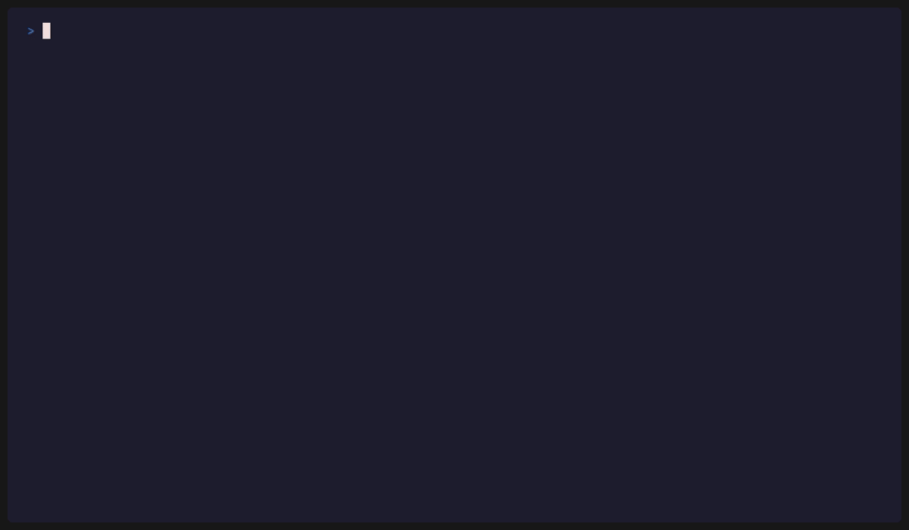

<div align="center">

# repovet

**Vet a Git repository before you run it.**

[](https://pypi.org/project/repovet/)
[](https://pypi.org/project/repovet/)
[](https://github.com/m3xXmo0/repovet/actions/workflows/ci.yml)
[](https://github.com/m3xXmo0/repovet/blob/main/LICENSE)

</div>

repovet reads a GitHub repository or a local folder as plain data and shows what could
run on your machine or steer your AI agent before you open, install or hand it over – it
never runs anything from it. To check changes later, `repovet diff` compares two
revisions and fails only on new or worse findings, so it can run in CI
([setup](https://github.com/m3xXmo0/repovet/blob/main/docs/usage.md#use-it-in-ci)).

## Why it matters

- **Opening it in an editor** can run code: VS Code tasks on folder open, dev containers, workspace settings.
- **Installing or building it** can run code: npm `postinstall`, `setup.py`, build hooks, Makefiles, Git hooks.
- **Letting an AI agent read it** can act on instructions hidden in `CLAUDE.md`, `AGENTS.md` or rule files.

## Quick start

```
pipx install repovet          # own environment, Python 3.12+
pip install repovet           # or into the current environment
uv tool install repovet       # no Python yet: uv fetches one
```

Then check a repository (or run `repovet` alone for a menu):

```
repovet scan https://github.com/m3xXmo0/repovet-demo
```

Real output (excerpt) for the demo repository, which is harmless but built on purpose
to trigger findings, so the high findings are expected:

```
repovet 0.5.1 | GitHub repository https://github.com/m3xXmo0/repovet-demo @ main (088b45582bfa) | offline | 16 files | 141 rules

+- SUMMARY -------------------------------------------------------------------+
| Do not install its dependencies or run its install scripts; do not let an   |
| AI coding agent work in it until you have read the findings below.          |
|                                                                             |
| 0 critical | 9 high | 5 medium | 1 low | 2 info                             |
|                                                                             |
| Look at these first                                                         |
| 1. HIGH      RC-AGENT-002  AGENTS.md:8                                      |
|    Hidden Unicode tag characters in an AI agent file                        |
| 2. HIGH      RC-BIN-002    assets/logo.png                                  |
|    Executable disguised as a document, image or text file                   |
| 3. HIGH      RC-AUTO-016   pyhelper/quicknote.pth:1                         |
|    .pth file with code                                                      |
+-----------------------------------------------------------------------------+
```

[](https://github.com/m3xXmo0/repovet-demo)

## Evidence, in short

These are small gap lists that show where repovet is blind, not detection rates. The
reconstructions and variants were built alongside the rules, so they show what the rules
are built for, not how well they generalize. The external sets and the benchmark were
measured with repovet 0.5.0; the reconstructions are scanned again on every test run.

- **Sealed blind list** (30 attack variants and 30 harmless cases, sealed before the first evaluation): 13 rated as expected, 2 detected lower or in another area, 15 of 30 missed; 25 of 30 harmless cases stay below medium.
- **Older holdout** (42 bypass variants and 24 harmless look-alikes written by a third party; partly independent since 0.4.1): 13 rated as expected, 13 detected lower or in another area, 16 missed; 23 of 24 look-alikes stay below medium.
- **16 of 16** reconstructions of documented attacks detected, and **60 of 64** hand-written evasion variants of them.
- **3 of 38** scanned most-starred GitHub repositories had a high or critical finding. These are popular, presumably harmless projects, so every high or critical hit there is a false alarm or worth a manual look.

In every report, read **"Not checked"** first. Details:
[docs/evidence.md](https://github.com/m3xXmo0/repovet/blob/main/docs/evidence.md).

## Scope

<!-- scope:start -->
repovet checks what a repository can do to you before you run it, and how it declares
its dependencies: whether a package name is plausible and where a package comes from. It
does not check whether a pinned version has known vulnerabilities; for that, use
[pip-audit](https://github.com/pypa/pip-audit),
[npm audit](https://docs.npmjs.com/cli/commands/npm-audit) or
[OSV-Scanner](https://github.com/google/osv-scanner). The analysis is offline because
of this scope: checking a repository must not run anything from it or send anything
about it elsewhere. repovet never calls a repository safe; it reports what its rules
detect and lists under "Not checked" what it could not look at.
<!-- scope:end -->

## Documentation

- [Using repovet](https://github.com/m3xXmo0/repovet/blob/main/docs/usage.md): step-by-step start, installation, all options, menu, `clone`, `diff`, CI
- [Reports and exit codes](https://github.com/m3xXmo0/repovet/blob/main/docs/reports.md): sample output, text, HTML, JSON, SARIF
- [What is checked](https://github.com/m3xXmo0/repovet/blob/main/docs/checks.md) and [every rule](https://github.com/m3xXmo0/repovet/blob/main/RULES.md)
- [Scope and limits](https://github.com/m3xXmo0/repovet/blob/main/docs/limits.md): what is not checked
- [Trust (GitHub API)](https://github.com/m3xXmo0/repovet/blob/main/docs/trust.md) · [Comparing commits](https://github.com/m3xXmo0/repovet/blob/main/docs/diff.md)
- [Evidence](https://github.com/m3xXmo0/repovet/blob/main/docs/evidence.md) · [Security model](https://github.com/m3xXmo0/repovet/blob/main/docs/security-model.md) · [FAQ](https://github.com/m3xXmo0/repovet/blob/main/docs/faq.md)
- [Development](https://github.com/m3xXmo0/repovet/blob/main/docs/development.md) · [Changelog](https://github.com/m3xXmo0/repovet/blob/main/CHANGELOG.md) · [Security policy](https://github.com/m3xXmo0/repovet/blob/main/SECURITY.md)

## License

MIT, see [LICENSE](https://github.com/m3xXmo0/repovet/blob/main/LICENSE). Copyright (c)
2026 m3xXmo0.

repovet ships two lists of package names as data (see `src/repovet/data/SOURCES.md`): the
most downloaded PyPI projects from "top-pypi-packages" by Hugo van Kemenade (CC BY 4.0),
and the most downloaded npm packages from npm-high-impact by Titus Wormer (MIT).
